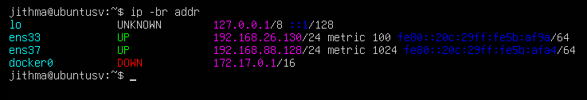
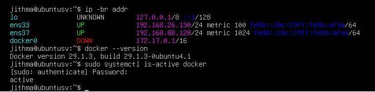
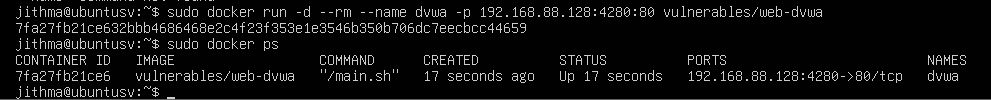
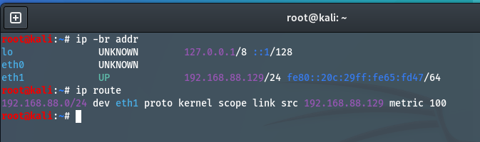
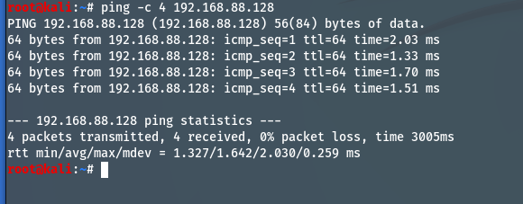
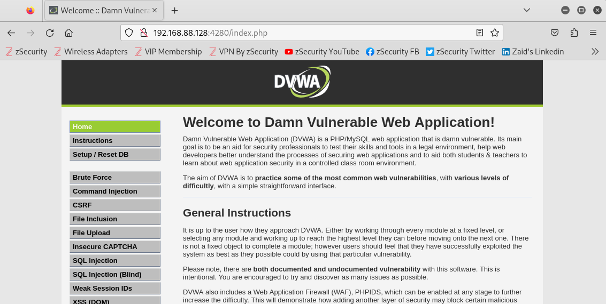

# Application Security Lab - Architecture

## 1. Project Overview

This project demonstrates the deployment and configuration of a controlled application security testing environment using VMware Workstation, Kali Linux, Ubuntu Server, Docker, and Damn Vulnerable Web Application (DVWA).

The objective is to develop practical skills in web application security testing, HTTP traffic analysis, vulnerability assessment, and security reporting.

## 2. Lab Environment

| Component | Technology | Purpose |
|---|---|---|
| Host Operating System | Windows 11 | Physical host |
| Hypervisor | VMware Workstation | Virtualization |
| Security Testing VM | Kali Linux | Security assessment |
| Target VM | Ubuntu Server 26.04.1 LTS | Application hosting |
| Container Platform | Docker | DVWA deployment |
| Target Application | DVWA | Intentionally vulnerable application |
| Web Security Tool | Burp Suite | HTTP traffic inspection |
| Assessment Tool | Nikto | Web server security scanning |

## 3. Network Architecture

Two VMware network adapters are configured on each virtual machine.

**NAT Network - 192.168.26.0/24**

- Provides outbound Internet connectivity.
- Used for operating system updates and software downloads.
- Kali interface: `eth0`
- Ubuntu interface: `ens33`

**Host-only Network - 192.168.88.0/24**

- Provides a dedicated network for security testing.
- Kali interface: `eth1`
- Ubuntu interface: `ens37`
- Allows communication between the testing and target virtual machines.

### Lab Diagram

```text
                   Windows 11 Host
                          |
                  VMware Workstation
                          |
              +-----------+-----------+
              |                       |
          Kali Linux             Ubuntu Server
              |                       |
       eth0: NAT                ens33: NAT
       eth1: Host-only          ens37: Host-only
              |                       |
              +---- 192.168.88.0/24 --+
                                      |
                                    Docker
                                      |
                                     DVWA
```

## 4. Application Deployment

DVWA is deployed inside a Docker container on Ubuntu Server.

The application is published on the Ubuntu Host-only interface using TCP port `4280`.

Example deployment command:

```bash
sudo docker run -d --rm --name dvwa -p 192.168.88.128:4280:80 vulnerables/web-dvwa
```

The IP address shown is an example from the lab and may change when DHCP leases are renewed.

## 5. Security Precautions

- Security testing is limited to an intentionally vulnerable application owned and controlled within the lab.
- DVWA is bound to the Ubuntu Host-only interface rather than all network interfaces.
- Bridged networking is avoided for the vulnerable target.
- The VMware Host-only network separates the lab from the physical apartment LAN, although the Windows host can also access that network.
- No unauthorized external systems are included in the testing scope.
- Credentials, session identifiers, and sensitive information are excluded or redacted from public documentation.

## 6. Evidence

### Ubuntu Network Configuration



### Docker Verification



### DVWA Container



### Kali Network Configuration



### Network Connectivity



### DVWA Application



## 7. Skills Demonstrated

- Virtual machine deployment and configuration
- Linux server administration
- Docker container deployment
- TCP/IP networking and routing
- NAT and Host-only network configuration
- Network segmentation fundamentals
- Application security testing environment preparation
- Technical documentation and evidence collection

## 8. Next Steps

The environment will be used for authorized web application security testing with Burp Suite and Nikto. Subsequent exercises will document HTTP traffic analysis, vulnerability identification, remediation recommendations, and validation results.
