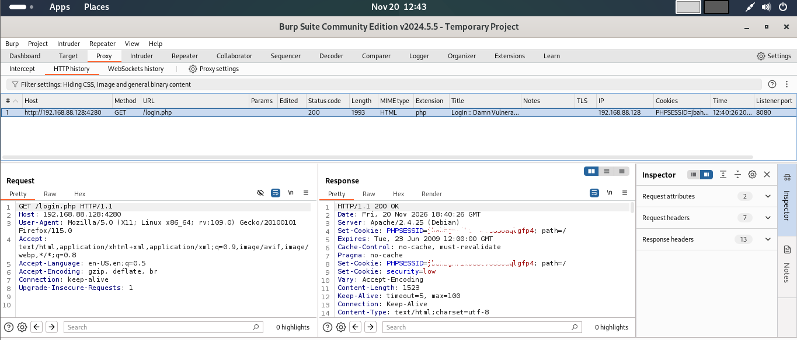
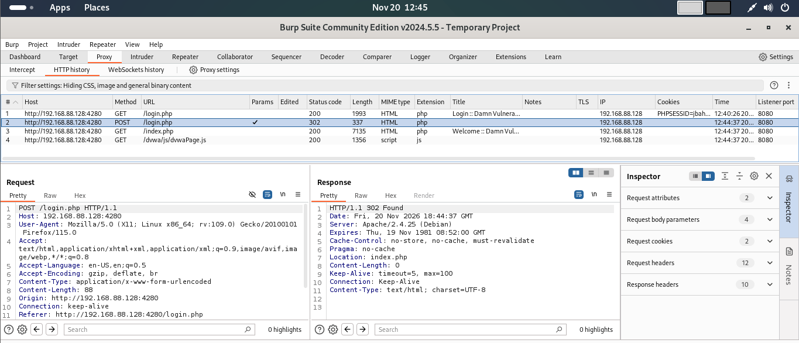
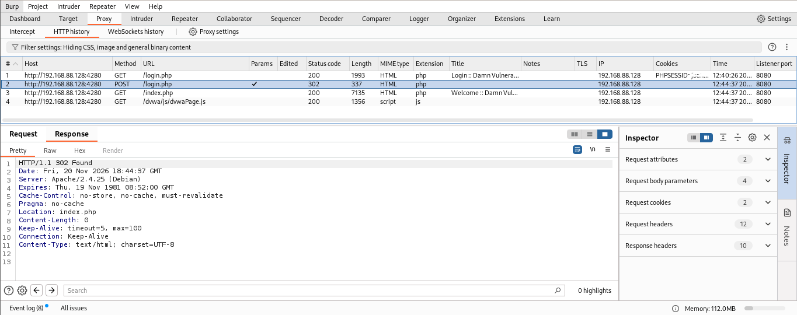

# Lab 01 - HTTP Traffic Analysis Using Burp Suite

## 1. Objective

Analyze HTTP communication between a web browser and an intentionally vulnerable web application using Burp Suite.

The objectives of this exercise were to:

- Capture HTTP GET and POST requests.
- Examine HTTP request and response headers.
- Understand the web application authentication workflow.
- Identify HTTP status codes and redirects.
- Observe how session cookies are transmitted.
- Document the results using screenshots and technical analysis.

## 2. Lab Environment

| Component | Technology |
|---|---|
| Testing Machine | Kali Linux |
| Target Server | Ubuntu Server |
| Target Application | Damn Vulnerable Web Application (DVWA) |
| Application Hosting | Docker |
| Testing Tool | Burp Suite Proxy |
| Browser | Firefox |
| Network | VMware Host-only network |
| Target URL | `http://192.168.88.128:4280` |

All testing was performed against an intentionally vulnerable application in a controlled, authorized lab environment.

## 3. Methodology

1. Started DVWA inside a Docker container on Ubuntu Server.
2. Accessed DVWA from Firefox on Kali Linux.
3. Configured Firefox to send HTTP traffic through Burp Suite Proxy.
4. Opened Burp Suite's Proxy → HTTP history.
5. Captured an HTTP GET request to the DVWA login page.
6. Submitted the DVWA login form using the lab's default credentials.
7. Captured the resulting HTTP POST request.
8. Examined the server's HTTP response and subsequent redirect.

## 4. Finding 01 - HTTP GET Request

**Request method:** GET  
**Resource:** `/login.php`  
**Observed status:** 200 OK

The browser sent an HTTP GET request to retrieve the DVWA login page.

The server returned an HTTP 200 response, indicating that the requested page was successfully delivered.

This demonstrates how HTTP GET is commonly used to retrieve webpages and resources.

### Evidence



## 5. Finding 02 — HTTP POST Request

**Request method:** POST  
**Resource:** `/login.php`  
**Observed status:** 302 Found

After the login form was submitted, Burp Suite captured a POST request to `/login.php`.

Unlike the GET request, the POST request submitted form parameters in the HTTP request body.

The request was associated with the application's authentication workflow.

### Evidence



## 6. Finding 03 - HTTP Login Response

The application returned the following response headers:

```http
HTTP/1.1 302 Found
Server: Apache/2.4.25 (Debian)
Cache-Control: no-store, no-cache, must-revalidate
Location: index.php
Content-Length: 0
Content-Type: text/html; charset=UTF-8
```

### Analysis

- **302 Found:** The application instructed the browser to navigate to another resource.
- **Location: index.php:** Identified the destination of the redirect.
- **Content-Length: 0:** Indicated that the response contained no message body.
- **Cache-Control:** Included directives intended to prevent caching.
- **Server:** Disclosed the Apache web server software and version.

After the POST request, the browser issued a GET request to `/index.php`, which returned HTTP 200.

This sequence was consistent with a successful DVWA login.

### Evidence



## 7. Authentication Workflow

```text
Kali Firefox
    |
    | GET /login.php
    v
DVWA Server
    |
    | HTTP 200 OK
    v
Login Page Displayed
    |
    | POST /login.php
    v
DVWA Server
    |
    | HTTP 302 Found
    | Location: index.php
    v
Kali Firefox
    |
    | GET /index.php
    v
DVWA Homepage — HTTP 200 OK
```

## 8. Security Observations

### Session Cookies

Burp Suite displayed a PHP session cookie named `PHPSESSID` and a DVWA security-level cookie.

Session cookies are used to associate browser requests with application state. Their security depends on appropriate handling, expiration, and cookie attributes.

### Authentication Traffic

Burp Suite demonstrated how login form submissions can be examined at the HTTP protocol level.

This reinforces the importance of HTTPS, secure session management, and server-side authentication controls.

### Information Disclosure

The observed response included the web server software and version in its `Server` header.

Version disclosure may provide useful reconnaissance information to an attacker, although the header alone does not establish that a vulnerability exists.

## 9. Key Learning Outcomes

This exercise demonstrated practical experience with:

- HTTP request and response analysis
- GET and POST methods
- HTTP headers and status codes
- Authentication workflows
- HTTP redirects
- Session cookies
- Burp Suite Proxy and HTTP History
- Security testing documentation

## 10. Conclusion

Burp Suite was successfully configured to capture and analyze HTTP communication between Kali Firefox and DVWA.

The exercise demonstrated the process of requesting a login page, submitting authentication data, interpreting the server's redirect response, and following the subsequent request to the application homepage.

This exercise established a foundation for subsequent application security testing, including vulnerability identification, request manipulation, and remediation analysis.

**Assessment scope:** Local DVWA lab only. No external websites or unauthorized systems were tested.
