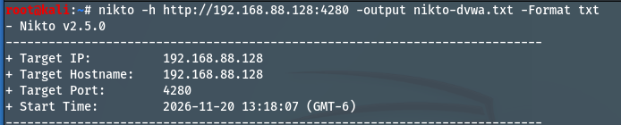
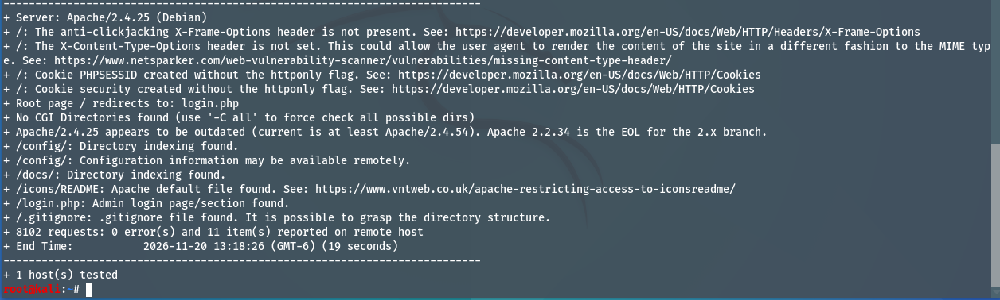
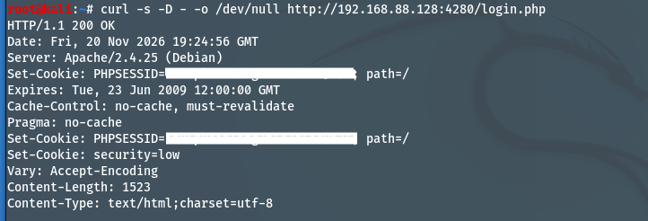
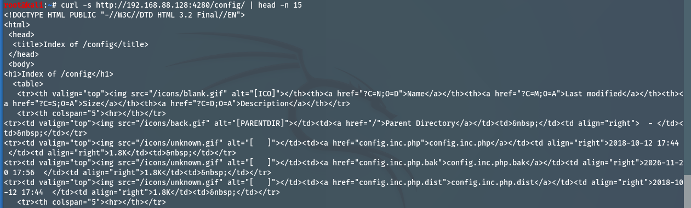
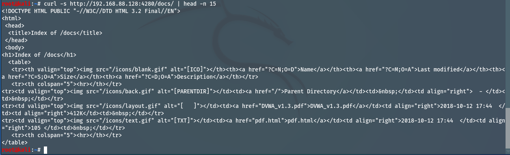

# Lab 02 - Web Application Reconnaissance and Security Configuration Assessment

## 1. Objective

Conduct an authorized reconnaissance assessment of an intentionally vulnerable web application using Nikto and manual HTTP verification.

The objectives were to:

- Identify web server software and configuration information.
- Detect missing HTTP security headers.
- Examine session cookie security attributes.
- Identify publicly accessible directories.
- Validate automated scanner findings manually.
- Document security risks and remediation recommendations.

## 2. Lab Environment

| Component | Technology |
|---|---|
| Testing Machine | Kali Linux |
| Target Server | Ubuntu Server |
| Target Application | Damn Vulnerable Web Application (DVWA) |
| Web Server | Apache/2.4.25 (Debian) |
| Application Hosting | Docker |
| Scanning Tool | Nikto |
| Verification Tool | curl |
| Network | VMware Host-only |
| Target URL | `http://192.168.88.128:4280` |

All testing was performed against an intentionally vulnerable application within an authorized, controlled lab.

## 3. Methodology

1. Verified connectivity to the DVWA server.
2. Executed a Nikto web server scan.
3. Reviewed the automated scan results.
4. Manually inspected HTTP response headers using curl.
5. Checked the accessibility of the `/config/` and `/docs/` directories.
6. Retrieved directory index pages to verify information exposure.
7. Documented the confirmed findings and remediation recommendations.

### Nikto Scan Command

```bash
nikto -h http://192.168.88.128:4280 -output nikto-dvwa.txt -Format txt
```

### Scan Summary

| Metric | Result |
|---|---|
| Hosts tested | 1 |
| Requests sent | 8,102 |
| Errors | 0 |
| Items reported | 11 |
| Scan duration | Approximately 19 seconds |

### Evidence





## 4. Finding 01 — Missing HTTP Security Headers

**Category:** Security misconfiguration  
**Verification status:** Confirmed  
**Affected endpoint:** `/login.php`

Manual inspection of the HTTP response identified the absence of:

- `X-Frame-Options`
- `X-Content-Type-Options`

### Verification Command

```bash
curl -s -D - -o /dev/null http://192.168.88.128:4280/login.php
```

### Security Impact

The absence of framing restrictions may allow the application to be embedded within another website, creating potential clickjacking exposure.

The absence of `X-Content-Type-Options: nosniff` removes an additional browser protection against certain MIME-type interpretation risks.

These observations identify missing defensive controls; exploitability was not demonstrated in this exercise.

### Recommended Remediation

- Implement an appropriate Content Security Policy using the `frame-ancestors` directive.
- Configure `X-Frame-Options: DENY` or `SAMEORIGIN` where appropriate.
- Configure `X-Content-Type-Options: nosniff`.
- Verify the headers are consistently applied to relevant application responses.

### Evidence



## 5. Finding 02 — Missing Session Cookie Security Attributes

**Category:** Session management configuration  
**Verification status:** Confirmed for observed response  
**Affected endpoint:** `/login.php`

The HTTP response included a PHP session cookie without the `HttpOnly` or `Secure` attributes.

### Security Impact

- Without `HttpOnly`, JavaScript executing within the application's origin may be able to access the session cookie.
- Without `Secure`, the cookie is not restricted to HTTPS connections.

The lab intentionally uses HTTP, but production authentication systems should use HTTPS and appropriately protected session cookies.

### Recommended Remediation

- Enable HTTPS in production.
- Apply `HttpOnly` to session cookies.
- Apply `Secure` to session cookies served over HTTPS.
- Configure an appropriate `SameSite` policy.
- Validate cookie attributes after implementation.

### Evidence

See Screenshot 12, which displays the observed `Set-Cookie` headers.

## 6. Finding 03 — Directory Listing Enabled in /config/

**Category:** Information disclosure  
**CWE:** CWE-548 — Exposure of Information Through Directory Listing  
**Verification status:** Confirmed  
**Affected endpoint:** `/config/`

Nikto reported directory indexing on the `/config/` endpoint.

Manual verification confirmed that the web server returned an HTML directory index.

### Verification Command

```bash
curl -s http://192.168.88.128:4280/config/ | head -n 15
```

### Observed Results

The response contained:

```html
<title>Index of /config</title>
<h1>Index of /config</h1>
```

The directory listing exposed filenames including:

- `config.inc.php`
- `config.inc.php.bak`
- `config.inc.php.dist`

### Security Impact

Public directory listing reveals application file structure and configuration-related filenames.

The presence of a backup configuration file may increase risk if its contents are also publicly retrievable.

This exercise confirmed filename exposure but did not establish whether the backup file contained sensitive information.

### Recommended Remediation

- Disable Apache directory indexing using `Options -Indexes`.
- Restrict public access to configuration directories.
- Remove backup configuration files from web-accessible locations.
- Store sensitive application configuration outside the document root.
- Retest the endpoint after remediation.

### Evidence



## 7. Finding 04 — Directory Listing Enabled in /docs/

**Category:** Information disclosure  
**CWE:** CWE-548  
**Verification status:** Confirmed  
**Affected endpoint:** `/docs/`

Manual verification confirmed that Apache displayed a directory listing at `/docs/`.

### Verification Command

```bash
curl -s http://192.168.88.128:4280/docs/ | head -n 15
```

### Observed Results

The response included:

```html
<title>Index of /docs</title>
<h1>Index of /docs</h1>
```

Visible filenames included:

- `DVWA_v1.3.pdf`
- `pdf.html`

### Security Impact

The directory listing exposes documentation filenames and may disclose information about the application's structure.

The observed files appear to be documentation, so the demonstrated impact is limited to information exposure.

### Recommended Remediation

- Disable unnecessary directory indexing.
- Restrict access to internal documentation where required.
- Remove files that are not intended for public distribution.

### Evidence



## 8. Additional Scanner Observations

Nikto also reported:

| Observation | Assessment |
|---|---|
| Apache/2.4.25 version | Older version string; patch status not verified |
| `/icons/README` accessible | Informational; default server file |
| `/login.php` identified | Expected login functionality |
| `/.gitignore` accessible | Potential information disclosure; not manually validated |

These observations require additional context or validation before being treated as confirmed vulnerabilities.

## 9. Findings Summary

| ID | Finding | Status | Priority |
|---|---|---|---|
| APP-01 | Missing HTTP security headers | Confirmed | Medium — provisional |
| APP-02 | Missing session cookie security attributes | Confirmed | Medium — provisional |
| APP-03 | Directory indexing in `/config/` | Confirmed | Medium — provisional |
| APP-04 | Directory indexing in `/docs/` | Confirmed | Low — provisional |

Priorities are preliminary qualitative assessments for this training environment, not formal CVSS scores. Production severity would depend on application functionality, exposure, affected data, and exploitability.

## 10. Key Learning Outcomes

This exercise demonstrated:

- Web application reconnaissance
- Nikto vulnerability scanning
- HTTP response header inspection
- Session cookie security analysis
- Directory indexing verification
- Information disclosure assessment
- Manual validation of automated scanner results
- Security reporting and remediation recommendations

## 11. Conclusion

The reconnaissance assessment identified several security configuration weaknesses in the DVWA training environment.

Nikto provided initial findings, which were then selectively verified using curl.

The assessment confirmed missing security headers, missing session cookie attributes, and directory indexing in two application directories.

No unauthorized systems were tested, and no credential compromise or exploitation was performed during this exercise.

**Assessment scope:** Locally hosted DVWA application within the VMware lab environment.
